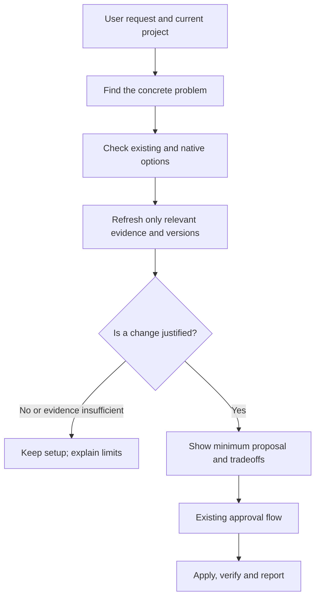

# Current tools and technology refresh: research before adoption

**5 November 2026, Europe/Moscow. Research, not an implementation plan.** Three
parallel source lanes and root synthesis extend the [earlier user-problem
study](../2026-11-05-user-problems/README.md). English is canonical; the adjacent
Russian copy is `README_ru.md`.

## Recommendation

**Keep Tibicen simple: refresh the evidence needed for the user's problem, then
recommend the smallest justified change, including no change.** A universal
mechanism that adopts whatever is fashionable is a poor fit. A bounded refresh
inside the existing init/adopt assessment is worth exploring. This is our product
judgment; the research does not measure demand for that feature or prove benefit.

The named tools solve different problems. Putting them into a default bundle
would add processes, data flows and maintenance before establishing a need.

| Tool/category | What it is for | Implication for Tibicen — proposed selection policy |
| --- | --- | --- |
| **SDD**, including Spec Kit, OpenSpec and Kiro | Preserve intent and coordinate changes through specifications and a workflow. SDD is a method, not one required product. | Preserve a useful existing process. For a bounded task, a short requirement and acceptance check can suffice; a framework needs a coordination problem to justify it. [Evidence](sdd-and-skills.md). |
| **Ponytail** | Instructions and, in the full distribution, additional plugin mechanisms for restrained implementation. | A relevant rule/skill can be enough. Full plugins, hooks and local state are a separate integration decision; “simple code” does not mean dropping required features. [Evidence](sdd-and-skills.md). |
| **mem0**, Letta, Zep/Graphiti | Different forms of retained agent/application memory and retrieval. | First distinguish project decisions from application end-user memory. Tibicen already has an optional project-file contract; an application memory backend is not a prerequisite for it. [Evidence](memory-services.md). |
| **Headroom**, probably the owner's “head… from Netflix” | Compress context through libraries, proxies or integrations. | It is associated with a former Netflix engineer, not established as a Netflix product. Compare native controls and focused output first; an external compressor needs a measured bottleneck and supported integration. [Evidence](context-tools.md). |

## What people complain about

The observations below are selected firsthand reports, not representative usage
statistics or defects reproduced here. Dates and later corrections matter.

| Reported problem | Evidence and counterevidence | Opportunity for Tibicen — inference |
| --- | --- | --- |
| **The process becomes harder to maintain than the change.** | SDD discussions describe paperwork and difficult iteration; other users value continuity. In a Russian Habr thread, Gromilo reports abandoning OpenSpec after a week because organizing/reviewing specs became unwieldy, yet says it could suit legacy changes. Other commenters dispute scope and verification assumptions. September 28–29, year omitted by returned page. [Original discussion](https://habr.com/en/companies/haulmont/articles/1085536/comments/), [SDD ledger](sdd-and-skills.md). | Scale the process to the task; retain existing useful conventions. A spec is not proof of compliance. |
| **Memory stores old and corrected facts without making the current choice clear; forgetting may be incomplete.** | Two open mem0 reports concern contradictions and residual session messages. October replies distinguish SDK/version and stubbed versus real-model observations. Historical audit and scope reports were closed. [Memory ledger](memory-services.md). | Clarify ownership, accepted state, correction and deletion before selecting storage. Do not turn every agent suggestion into a durable decision. |
| **Token reduction does not necessarily reduce bills or preserve the needed detail.** | Headroom reports include cache rewrites, recovery trouble and resource pressure. Two are closed, one remains open; a cache/direct comparison worked better for the same reporter. A main-branch fix is not proof of a fixed installed package. [Context ledger](context-tools.md). | Assess task correctness, cache billing, recovery and runtime cost, not a token percentage alone. |
| **An update changes somebody's carefully maintained rules.** | A December 3, 2025 Spec Kit author reports a constitution overwritten during upgrades; version unspecified, current behavior unverified. Historical evidence of an ownership problem, not a claim about today's release. [Original report](https://github.com/github/spec-kit/discussions/1278). | Separate vendor templates from user-owned decisions; show the exact change and preserve local content. |
| **“Up to date” can refer to the catalog, installed files or the active session.** | Claude Code #17361 remains open, but an October 2 correction reports successful automatic updates on 2.1.286 and explains earlier test mistakes. Current official docs distinguish disk updates from session reload. [Thread and correction](https://github.com/anthropics/claude-code/issues/17361), [current docs](https://code.claude.com/docs/en/plugins/install). | Identify the actual layer and version before proposing a workaround. Do not retain a disproved old complaint as current guidance. |

An author's [archspec demonstration](https://habr.com/ru/articles/1037988/), dated
May 26 with year omitted in the returned page, offers another approach: deriving
architecture views from structured service contracts. It is a tool-owner demo,
not independent proof that another specification layer improves real projects.
It supports investigating cross-service context when that is the actual problem,
not installing another framework everywhere.

## What Tibicen already has, and what is still missing

The code observations in this section describe the pre-implementation local
snapshot `d1f64a49e1332b7b7bdb4ae12174cbd647b22645`. The later, separately approved
[version-input change](../../../openspec/changes/archive/2026-11-05-bind-practice-evidence-to-agent-versions/proposal.md)
addresses the CLI gap below as Unreleased work. That follow-up does not alter
this study's original evidence or establish measured benefit.

The [product vision](../../PRODUCT_VISION.md) already calls for current primary
sources, native facilities first, one sufficient optional recommendation,
preservation and explicit updates. [Release policy](../../RELEASING.md) prohibits
background mutation of the installed product or project setup. This study does
not reverse those boundaries.

Actual code gives a narrower, useful starting point:

- [Practice discovery](../../../scripts/discovery/practices.ts) fetches bounded
  official pages for selected supported agents, records access/hash and reports
  uncertainty. Applicability remains `requires-agent-assessment`; fetching a page
  does not verify its advice or a resulting project improvement.
- Its helper accepts agent versions, but the current
  [CLI call](../../../scripts/tibicen.ts) passes selected agents without installed
  version values. It reports missing version binding rather than establishing it.
- Existing component discovery and [agent-architecture rules](../../../references/stage-agent-arch.md)
  cover source/trust selection. They are not universal adapters for application
  backends or provider proxies. Current stdio MCP support does not configure a
  model HTTP proxy.
- [Project memory](../../PROJECT_MEMORY.md) already retains approved decisions in
  one chosen store. [Adopt diagnosis](../../ADOPT_DIAGNOSIS.md), currently
  Unreleased, explains current structure and next steps. Neither needs a new
  memory service merely because one exists.

The most defensible gap is therefore **binding evidence to the actual environment
and explaining why it changes a recommendation**, not building a trend catalog.
Price, data flow, license, release availability and upstream corrections can
change independently. The lane notes contain examples of stale search snippets,
dated privacy prose and evolving licensing. “Checked today” alone cannot resolve
those differences.

## A small refresh mechanism to consider

Keep four operations distinct:

| Operation | Proposed boundary |
| --- | --- |
| Update Tibicen itself | Explicit installation of a reviewed, versioned release. |
| Refresh evidence | Read relevant official sources for the selected task/version; treat fetched text as data. |
| Change selection rules or adapters | Maintainer review, preservation checks and a versioned release; web text must not rewrite executable policy. |
| Change the user's project | A concrete diff/commands, existing consent boundary, checks and removal/recovery instructions. |

The user-facing flow can stay short:

Five questions are enough to guide the assessment: What problem is observed? Can
the existing setup handle it? Does the source apply to this version? Are the data,
operating cost and maintenance acceptable? How will success and removal be checked?

A future evidence record should retain source/date/version, the relevant claim,
its status and the reason to reconsider it. A closed issue can supersede an old
warning; a fix only on main can remain unavailable to the installed release.
Recheck on a relevant environment change, an affected recommendation or an
explicit assessment, rather than running a background crawler. Network failure
means dated/unknown evidence, not invented freshness or permission to install a
fallback. Reuse existing report/proposal structures before adding storage.

Security is another reason to separate freshness from permission. The official
[Cline advisory](https://github.com/cline/cline/security/advisories/GHSA-9ppg-jx86-fqw7)
records an unauthorized CLI 2.3.0 publish on February 17, 2026 that added an
unintended global package install; 2.4.0 corrected it. IDE extensions were
unaffected. This historical incident does not establish current Cline risk, but
shows why a newer artifact cannot authorize additional side effects.

For ordinary application-dependency updates, inspect an existing updater such as
[Renovate](https://docs.renovatebot.com/configuration-options/#minimumreleaseage)
instead of building one inside Tibicen. Release age and passing checks are useful
controls, not proof that an update benefits the user. Replacing an existing app's
framework/database or adding its memory business logic is outside Tibicen's
current infrastructure scope. For a new project, an empty directory likewise
does not justify installing a complete AI tooling stack.

## Next work, if selected

1. Specify one bounded improvement to existing adopt: bind selected-agent evidence
   to observed versions and explain keep/change/unknown. First confirm which gaps
   are code defects versus agent-assessment guidance. No new command or schema is
   assumed necessary.
2. Check it on small contrasting cases: a bounded task needing no SDD framework;
   an existing useful process; approved project decisions needing only a file;
   stale evidence corrected upstream; a fix not yet released; unavailable sources.
   Preserve the no-change result and user content.
3. Evaluate a named service/proxy only for a demonstrated unsupported task, against
   the same native/file baseline. The lane notes propose correction/deletion tests
   for memory and correctness/cache/cost/recovery tests for compression. These
   evaluations have not run and are not implied by this research.

No default mem0/Headroom/Ponytail bundle, always-running trend watcher, new global
memory database or automatic project migration is justified by this sample.
Detailed implementation would require its own scoped OpenSpec change. The study
does not change shipped behavior, version or release status.

## Evidence and limits

Read the dated source ledgers in [SDD and skills](sdd-and-skills.md),
[memory services](memory-services.md) and [context tools](context-tools.md).
Root additionally inspected the linked update/ownership/security/native-updater
sources and Russian article/discussion, and compared actual repository code.
Do not sum lane counts as unique sources; native documentation overlaps.

This is a purposive qualitative sample of official docs/source and original
issues/posts, mostly English with two Russian pages. There is no population
frequency, representative survey, authenticated measurement corpus, independent
tool ranking or demonstrated Tibicen benefit. Rival-tool promotions and vendor
benchmarks remain labeled. Living docs/main are not installed-version bindings.
Context7 was unavailable; official web/source fallback was used. Some discussion
timestamps omit the year or are relative, and exact issue update metadata was
unavailable. No installs, private workloads, model trials or paid APIs were used.

Three agents researched separate lanes; an agent independently reviewed the
other lane evidence and the synthesis was checked separately. Completion and
actual documentation checks are recorded in the
[research dashboard](../../../.scratch/technology-refresh-research/dashboard.md).
