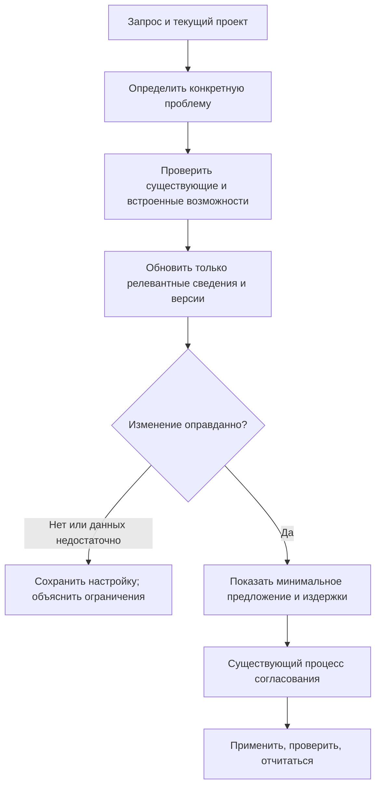

# Актуальные инструменты и обновление рекомендаций: сначала исследование

**5 ноября 2026 года, Europe/Moscow. Исследование, а не план реализации.** Три
параллельных направления и итоговый анализ дополняют [предыдущее исследование
проблем пользователей](../2026-11-05-user-problems/README.md). Каноническая версия
документа — соседний английский `README.md`.

## Рекомендация

**Сохранить Tibicen простым: обновлять сведения, нужные для задачи пользователя,
и предлагать минимальное обоснованное изменение, включая отсутствие изменений.**
Универсальный механизм внедрения всего модного плохо подходит продукту. Стоит
рассмотреть ограниченную проверку актуальности внутри существующей оценки
init/adopt. Это наш продуктовый вывод: исследование не измеряет спрос на такую
функцию и не доказывает её пользу.

Названные инструменты решают разные задачи. Их установка общим пакетом добавит
процессы, передачу данных и сопровождение до выяснения потребности.

| Инструмент/категория | Для чего нужен | Вывод для Tibicen — предлагаемое правило выбора |
| --- | --- | --- |
| **SDD**, включая Spec Kit, OpenSpec и Kiro | Сохранять замысел и координировать изменения через спецификации и процесс работы. SDD — подход, а не один обязательный продукт. | Сохранять полезный существующий процесс. Для небольшой задачи могут хватить короткого требования и проверки результата; фреймворк должен решать проблему координации. [Материалы](sdd-and-skills.md). |
| **Ponytail** | Инструкции, а в полной поставке — дополнительные механизмы плагина для сдержанной реализации. | Может хватить подходящего правила/скилла. Полный плагин, hooks и локальное состояние — отдельное решение об интеграции; простота кода не означает отказ от обязательных функций. [Материалы](sdd-and-skills.md). |
| **mem0**, Letta, Zep/Graphiti | Разные формы памяти и поиска для агентов и приложений. | Сначала различить решения проекта и память о пользователях приложения. У Tibicen уже есть необязательная память в файле проекта; сервер памяти приложения для неё не требуется. [Материалы](memory-services.md). |
| **Headroom**, вероятно, упомянутый «head… от Netflix» | Сжимать контекст через библиотеки, прокси или интеграции. | Связан с бывшим инженером Netflix; принадлежность Netflix не установлена. Сначала сравнить встроенные возможности и точечный вывод; внешнему компрессору нужны подтверждённая измерениями проблема и поддерживаемая интеграция. [Материалы](context-tools.md). |

## На что жалуются люди

Ниже — отобранные сообщения участников, а не репрезентативная статистика или
воспроизведённые нами ошибки. Даты и поздние исправления выводов важны.

| Описанная проблема | Свидетельства и ограничения | Возможность для Tibicen — наш вывод |
| --- | --- | --- |
| **Процесс поддерживать труднее, чем само изменение.** | В обсуждениях SDD жалуются на документационную нагрузку и сложность итераций; другие ценят преемственность. На Хабре Gromilo пишет, что отказался от OpenSpec через неделю из-за организации и ревью спек, но допускает его пользу для legacy. Другие участники спорят об области применения и проверке. 28–29 сентября; год в полученной странице не указан. [Обсуждение](https://habr.com/en/companies/haulmont/articles/1085536/comments/), [реестр SDD](sdd-and-skills.md). | Масштабировать процесс под задачу, сохранять полезные привычки. Спецификация не доказывает соответствие реализации. |
| **Память хранит старое и исправленное, не выделяя актуальное; забывание может быть неполным.** | Два открытых сообщения mem0 касаются противоречий и оставшихся сообщений сессии. Октябрьские ответы уточняют SDK/версию и различают подменённые провайдеры и настоящую модель. Исторические сообщения об аудите и области данных закрыты. [Реестр памяти](memory-services.md). | До выбора хранилища определить владельца, принятое состояние, исправление и удаление. Не превращать каждое предложение агента в постоянное решение. |
| **Меньше токенов не обязательно означает меньший счёт и сохранение нужной детали.** | В Headroom сообщают о перезаписи кэша, проблемах восстановления и расходе ресурсов. Два сообщения закрыты, одно открыто; у того же автора режим cache и прямое подключение работали лучше. Исправление на main не доказывает исправления установленного пакета. [Реестр контекста](context-tools.md). | Оценивать правильность задачи, оплату кэша, восстановление и ресурсы, а не только процент сжатия. |
| **Обновление меняет тщательно настроенные правила.** | 3 декабря 2025 года автор сообщения Spec Kit описал перезапись constitution при обновлении; версия не названа, текущее поведение не проверено. Это исторический пример проблемы владения, а не утверждение о сегодняшней поставке. [Исходное сообщение](https://github.com/github/spec-kit/discussions/1278). | Различать шаблоны поставщика и решения пользователя; показывать точное изменение и сохранять локальный текст. |
| **«Обновлено» может относиться к каталогу, установленным файлам или активной сессии.** | Claude Code #17361 остаётся открытым, но в исправлении от 2 октября автор подтвердил успешное автообновление на 2.1.286 и объяснил прежние ошибки проверки. Текущая документация разделяет обновление на диске и перезагрузку сессии. [Обсуждение с исправлением](https://github.com/anthropics/claude-code/issues/17361), [документация](https://code.claude.com/docs/en/plugins/install). | До обходного решения определить реальный слой и версию. Не хранить опровергнутую старую жалобу как актуальную рекомендацию. |

Авторская [демонстрация archspec](https://habr.com/ru/articles/1037988/) от 26 мая
(год в полученной странице не указан) предлагает другой подход: строить
архитектурные представления из структурированных контрактов сервисов. Это демо
владельца инструмента, а не независимое доказательство пользы ещё одного слоя
спецификаций. Оно даёт повод исследовать межсервисный контекст при такой задаче,
а не устанавливать ещё один фреймворк всем.

## Что в Tibicen уже есть и чего пока не хватает

Наблюдения кода в этом разделе описывают локальный снимок до реализации
`d1f64a49e1332b7b7bdb4ae12174cbd647b22645`. Позднее отдельно одобренное
[изменение ввода версий](../../../openspec/changes/archive/2026-11-05-bind-practice-evidence-to-agent-versions/proposal.md)
устраняет описанный ниже пробел CLI как работу Unreleased. Оно не меняет исходные
свидетельства исследования и не доказывает измеренную пользу.

[Продуктовое видение](../../PRODUCT_VISION.md) уже требует актуальных первичных
источников, приоритета встроенных возможностей, одной достаточной необязательной
рекомендации, сохранения полезного и явного обновления. [Политика
релизов](../../RELEASING.md) запрещает фоновую мутацию установленного продукта или
настройки проекта. Исследование эти границы не отменяет.

Реальный код даёт более узкую полезную основу:

- [Поиск практик](../../../scripts/discovery/practices.ts) ограниченно загружает
  официальные страницы выбранных поддерживаемых агентов, сохраняет дату/хэш и
  неопределённость. Применимость остаётся `requires-agent-assessment`: загрузка
  страницы не подтверждает правильность совета или улучшение проекта.
- Вспомогательная функция принимает версии агентов, но текущий
  [вызов CLI](../../../scripts/tibicen.ts) передаёт выбранных агентов без значений
  установленных версий. Отсутствие привязки сообщается, а не считается проверкой.
- Поиск компонентов и [правила архитектуры агентов](../../../references/stage-agent-arch.md)
  охватывают выбор источников и доверие. Это не универсальные адаптеры для памяти
  приложений или прокси провайдера. Текущая поддержка stdio MCP не настраивает
  HTTP-прокси модели.
- [Память проекта](../../PROJECT_MEMORY.md) уже хранит одобренные решения в одном
  выбранном месте. [Диагностика adopt](../../ADOPT_DIAGNOSIS.md), пока Unreleased,
  объясняет текущую структуру и следующие шаги. Ни одной из этих возможностей не
  нужен новый сервис памяти просто из-за его появления.

Поэтому наиболее обоснованный пробел — **связать свидетельства с реальной средой
и объяснять, почему они меняют рекомендацию**, а не создавать каталог трендов.
Цена, передача данных, лицензия, доступность исправления в релизе и уточнения
авторов меняются независимо. В материалах есть примеры устаревших поисковых
сниппетов, старого описания приватности и меняющегося лицензирования. Отметка
«проверено сегодня» сама по себе этих различий не разрешает.

## Небольшой механизм обновления для рассмотрения

Нужно различать четыре операции:

| Операция | Предлагаемая граница |
| --- | --- |
| Обновить сам Tibicen | Явная установка проверенного версионированного релиза. |
| Обновить сведения | Прочитать релевантные официальные источники для выбранной задачи/версии; считать загруженный текст данными. |
| Изменить правила выбора или адаптеры | Ревью сопровождающего, проверки сохранности и версионированный релиз; веб-текст не переписывает исполняемую политику. |
| Изменить проект пользователя | Конкретный diff/команды, существующая граница согласования, проверки и удаление/восстановление. |

Пользовательский путь остаётся коротким:

Оценку направляют пять вопросов: какая проблема наблюдается? Справится ли текущая
настройка? Подходит ли источник этой версии? Приемлемы ли данные, расходы и
сопровождение? Как проверять успех и удаление?

Будущей записи о свидетельстве достаточно сохранить источник/дату/версию,
относящееся к решению утверждение, статус и причину пересмотра. Закрытая ошибка
может отменить старое предупреждение; исправление только на main может ещё не
попасть в установленный релиз. Повторная проверка нужна при релевантном изменении
среды, затронутой рекомендации или явной оценке, а не через фоновый сборщик всего
интернета. Сбой сети означает старые/неизвестные сведения, а не выдуманную
актуальность или разрешение установить замену. Сначала переиспользовать
существующие отчёты/предложения, затем решать, нужно ли новое хранилище.

Безопасность также требует различать свежесть и разрешение. Официальный
[advisory Cline](https://github.com/cline/cline/security/advisories/GHSA-9ppg-jx86-fqw7)
фиксирует неавторизованную публикацию CLI 2.3.0 от 17 февраля 2026 года с лишней
глобальной установкой пакета; 2.4.0 исправила её. Расширения IDE не затронуты.
Исторический инцидент не доказывает текущий риск Cline, но показывает: более новый
артефакт не разрешает дополнительные побочные действия.

Для обычного обновления зависимостей приложения стоит рассмотреть уже существующий
обновлятор, например [Renovate](https://docs.renovatebot.com/configuration-options/#minimumreleaseage),
вместо разработки своего внутри Tibicen. Возраст релиза и пройденные проверки
полезны, но не доказывают пользу обновления. Замена фреймворка/БД существующего
приложения или добавление его бизнес-логики памяти выходит за текущую область
агентской инфраструктуры Tibicen. В новом проекте пустая папка тоже не оправдывает
установку полного набора AI-инструментов.

## Следующие работы, если их выберем

1. Описать одно ограниченное улучшение существующего adopt: привязывать сведения
   о выбранных агентах к наблюдаемым версиям и объяснять сохранить/изменить/неизвестно.
   Сначала отделить дефекты кода от инструкций оценки агентом. Новая команда или
   схема данных заранее не предполагаются.
2. Проверить на небольших контрастных случаях: малая задача без необходимости SDD;
   полезный существующий процесс; принятые решения, которым достаточно файла;
   устаревшее свидетельство с исправлением автора; ещё не выпущенное исправление;
   недоступные источники. Сохранять возможность ничего не менять и текст пользователя.
3. Оценивать конкретный сервис/прокси только для наблюдаемой неподдержанной задачи
   относительно тех же встроенных возможностей/файлов. В материалах предложены
   проверки исправления/удаления для памяти и правильности/кэша/цены/восстановления
   для сжатия. Они ещё не выполнены и этим исследованием не запускаются.

Выборка не оправдывает стандартный пакет mem0/Headroom/Ponytail, постоянный
мониторинг трендов, новую глобальную БД памяти или автоматическую миграцию
проекта. Подробная реализация потребует отдельного ограниченного OpenSpec change.
Исследование не меняет поставляемое поведение, версию или статус релиза.

## Свидетельства и ограничения

Датированные реестры источников находятся в материалах [SDD и
скиллов](sdd-and-skills.md), [сервисов памяти](memory-services.md) и [инструментов
контекста](context-tools.md). Интегратор дополнительно прочитал связанные источники
об обновлении, владении, безопасности, готовом обновляторе, русскую статью и
обсуждение, сопоставил их с реальным кодом. Складывать числа направлений как число
уникальных источников нельзя: встроенная документация пересекается.

Это целевая качественная выборка официальных документов/кода и исходных
сообщений, преимущественно английская с двумя русскими страницами. Нет частоты
проблем в популяции, репрезентативного опроса, подтверждённого корпуса измерений,
независимого рейтинга инструментов или доказанной пользы Tibicen. Реклама
конкурирующих инструментов и замеры поставщиков обозначены. Живые docs/main не
подтверждают установленную версию. Context7 недоступен; использованы официальные
веб-страницы/код. Некоторые даты без года или относительные, точные метаданные
обновления issues недоступны. Установок, частных проектов, модельных прогонов и
платных API не было.

Три агента исследовали отдельные направления; агент независимо проверил
свидетельства других направлений, итоговый анализ проверен отдельно. Завершение и
фактически выполненные проверки документов записаны в
[дэшборде исследования](../../../.scratch/technology-refresh-research/dashboard.md).
