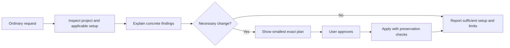

# User problems Tibicen can address without becoming a platform

Later follow-up: the owner authorized the selected [adopt diagnosis packet](../../ADOPT_DIAGNOSIS.md)
after this study. Research-only scope and validation below describe completion
of this study, not the later implementation working tree.

**5 November 2026, Europe/Moscow · baseline: published 1.1.0.** The
[current-capability snapshot](../../CURRENT_CAPABILITIES.md) records the released
product. This study proposes directions; it neither implements them nor replaces
the [product vision](../../PRODUCT_VISION.md). English is canonical; adjacent
Russian translations accompany every guide.

## Recommendation

Keep one understandable job: **“Put this project's agent setup in order, preserve
what matters to me, and show what is ready.”** Initial setup is the same job
starting from little infrastructure; maintenance starts from existing files.

Different complaints can share the existing lifecycle: inspect actual files and
supported agent contracts, identify a concrete issue, propose the smallest
change, apply the approved diff safely, and report separate checks. Improve
diagnosis and the handoff inside init/adopt before adding a new backend,
configurator or agent engine. This is a product judgment, not measured demand
or proven comparative benefit.

## What people describe

The ordinary requests below are synthesized examples, not quotations. A public
account establishes a reported experience, not a reproduced cause or prevalence.

| User problem                                              | Primary public signal                                                                                                                                                                                                                                                                                                                       | Coverage today                                                                  | Smallest useful direction                                                                                                           |
| --------------------------------------------------------- | ------------------------------------------------------------------------------------------------------------------------------------------------------------------------------------------------------------------------------------------------------------------------------------------------------------------------------------------- | ------------------------------------------------------------------------------- | ----------------------------------------------------------------------------------------------------------------------------------- |
| “What agent stuff does this project need?”                | An overwhelmed author already uses native init. [Thread](https://www.reddit.com/r/ClaudeAI/comments/1m0gqro/claude_code_too_many_workflows/)                                                                                                                                                                                                | Init/adopt recommend one sufficient setup.                                      | Explain what to keep and why; make “no changes needed” useful.                                                                      |
| “The rules exist. Why don't they work?”                   | A Codex author separates reading from later compliance. [Issue](https://github.com/openai/codex/issues/25884)                                                                                                                                                                                                                               | Structural checks and conditional behavioral observations differ.               | Distinguish configuration defects, expected loading, observed loading and task behavior.                                            |
| “Rules have spread everywhere.”                           | A historical mixed-agent monorepo report describes excessive context. [Forum](https://forum.cursor.com/t/cursor-loads-all-rules-from-all-folders-in-monorepo-and-blows-past-context-limits/165337)                                                                                                                                          | Adopt can propose smaller instructions while preserving decisions.              | Explain relevant scope and registered duplicates; justify each change. No universal size score or automatic vendor-only conversion. |
| “I repeat everything; old decisions also get in the way.” | Memory discussions contain both repeated-context complaints and objections to stale decisions. [Repeated explanations](https://www.reddit.com/r/ClaudeAI/comments/1tyszhi/how_are_people_giving_claude_useful_memory/), [counterexample](https://www.reddit.com/r/ClaudeAI/comments/1w3cqcn/memory_on_or_off_i_dont_see_any_advantage_for/) | 1.1 provides one optional project file and read/update/correction rules.        | Review accepted knowledge, reasons and superseded decisions without a second automatic store.                                       |
| “It works in my terminal, but the agent's tool fails.”    | A version-specific MCP report concerns child-process environment. [Issue](https://github.com/openai/codex/issues/29124)                                                                                                                                                                                                                     | MCP syntax and environment-readiness states exist.                              | Explain the target launch context and unknowns; prefer native diagnostics before rewriting configuration.                           |
| “An update will erase this.”                              | A Cursor exchange warns about editing a plugin cache. [Forum](https://forum.cursor.com/t/settings-for-plugins-from-cursor-marketplace/156236)                                                                                                                                                                                               | Exact approved writes, hashes, history and recovery protect Tibicen operations. | Show ownership and the supported edit location. Another program's future writes remain outside Tibicen's control.                   |
| “We switch agents. Which copies should stay?”             | Multi-tool context discussion and an original MCP configuration article. [Gemini](https://github.com/google-gemini/gemini-cli/discussions/1471), [author's article](https://dev.to/haoli/i-pasted-the-same-mcp-server-into-4-config-files-then-i-wrote-a-tool-to-clean-up-the-mess-m8g)                                                     | Two exact shared-rule contracts and selected MCP adapters exist.                | Compare only selected targets. Each client may legitimately need its own registration.                                              |

Dated ledgers, native alternatives and counterexamples:
[instructions and scope](instructions.md), [memory and decisions](memory.md),
[setup and maintenance](setup.md). Historical bugs must retain those
qualifications in any future landing copy.

## One mechanism, several needs

Most of this loop is implemented. The opportunity is more precise, understandable
output, plus a bounded check only where existing checks/native diagnostics
cannot answer the question.

| Shared building block                                   | Problems it can help address                                                                                                         |
| ------------------------------------------------------- | ------------------------------------------------------------------------------------------------------------------------------------ |
| Inventory with path, agent/version, scope and ownership | Wrong entry points, confusing copies, incompatible formats, edits to a managed cache.                                                |
| Small instructions and one user-owned decision file     | Repeated explanations, contradictory current decisions and unnecessary always-loaded context. Judgment and user intent still matter. |
| Exact approved edits and original-content checks        | Template replacement, unintended deletion, stale plans and interrupted work. Already implemented.                                    |
| Separate configuration/loading/use outcomes             | False confidence from file existence, valid config with untested startup, unsupported environments.                                  |
| A short next-action report                              | Unclear completion, hidden manual steps and troubleshooting without visible progress.                                                |

These are shared concepts, not five new subsystems. Preserve two skills and local
operation; a sufficient native setup is a valid outcome. Machine-wide inventory,
transcript indexing and automatic hooks would introduce different privacy and
execution contracts.

## Proposed order

Order reflects **fit and reuse**, not complaint frequency, implementation-day
estimates or an approved backlog.

| Order | Proposed result                                                                                                      | Reuse and boundary                                                                                   | Keep it only if                                                                           |
| ----- | -------------------------------------------------------------------------------------------------------------------- | ---------------------------------------------------------------------------------------------------- | ----------------------------------------------------------------------------------------- |
| 1     | One plain adopt result: starting setup, concrete issue, keep/change decision, exact diff, checks and next step.      | Existing scan/status/verify/report and agent instructions; strong native overlap.                    | Both repair and no-change outcomes are understandable without evaluation vocabulary.      |
| 2     | Relevant instruction files explained for the selected agent/version, working directory and target path.              | Inventory/shared-rule checks plus only missing bounded adapter facts. No universal loader simulator. | A configuration defect differs from noncompliance; intentional scope differences survive. |
| 3     | Review existing project memory during adopt: current, clearly superseded and uncertain knowledge.                    | Existing one-file contract and exact diff. No database, store migration or mandatory entry schema.   | Corrections preserve unrelated notes and disclose uncertain intent.                       |
| 4     | Clear local integration diagnosis: format, executable availability, environment evidence and remaining native check. | Existing MCP states and approved commands; new launch-context checks need a scoped contract.         | Configured does not mean healthy; secrets and security protections stay intact.           |
| Later | Additional agent/process/remote-service adapters.                                                                    | Each adds version, scope, trust and maintenance obligations.                                         | A concrete unsupported task justifies it and native configuration is insufficient.        |

Combine the first two into the next **proposal**, rather than opening four
implementation tracks. Include memory/environment explanations only when they
serve that same result. Substantial behavior needs an OpenSpec change and an
implementation instruction; this research does not authorize implementation.

## What limits the promise

Native alternatives are substantial: Claude documents instruction audits/MCP
management, Gemini configurable context filenames, and Microsoft APM multi-target
configuration/ownership reconciliation. Exact sources are in the lanes. A file,
a diff or preservation alone does not establish differentiation.

Three papers from the earlier study were reopened, not counted as new studies:

| Primary paper / inspected version                                                                                                | Narrow result and limit                                                                                                                                                  |
| -------------------------------------------------------------------------------------------------------------------------------- | ------------------------------------------------------------------------------------------------------------------------------------------------------------------------ |
| [Evaluating AGENTS.md](https://arxiv.org/html/2602.11988v3), v3, 29 September 2026                                               | In its Python settings, context did not significantly improve success and increased cost. It does not test Tibicen or prove all instructions harmful.                    |
| [On the Impact of AGENTS.md Files on the Efficiency of AI Coding Agents](https://arxiv.org/html/2601.20404v2), v2, 30 March 2026 | Reports efficiency differences across 124 PR tasks/10 repositories; full semantic correctness was outside scope. Faster output is not established useful completion.     |
| [Do Context Files Help Coding Agents?](https://arxiv.org/html/2607.27250v1), v1, 28 July 2026                                    | Two-agent/three-repository ablation found no measurable correctness effect within stated bounds. Narrow tasks and detection limits prevent a universal no-benefit claim. |

The original [Armin Ronacher article](https://lucumr.pocoo.org/2025/6/12/agentic-coding/),
12 June 2025, was also reopened. His preference for ordinary tools and limited
MCP counters mandatory integrations. This is dated personal practice, not an
efficacy trial; its permission choices are not adopted.

Do not promise to fix model reasoning, vendor compaction bugs, instruction
compliance, context-window limits or all memory loss. Tibicen can repair a
supported configuration defect and explain remaining uncertainty. Actual benefit
still needs observation; source counts and agent reviewers cannot measure human
time savings or choose private team policies.

## Assess a proposal without another owner questionnaire

Compare against an ordinary native audit on the same starting files. Include an
already sufficient setup, a masked/missing instruction connection, intentional
root/subtree differences, a stale managed copy, corrected memory with unrelated
notes, and unknown target environment.

Check the concrete defect found, unnecessary changes avoided, preserved bytes,
honesty of loading/startup claims and clarity of the next action. Reuse offline
fixtures. Fresh model execution needs a separate finite protocol; none was
launched here. This assesses technical behavior, not human usefulness. No new
owner questionnaire or participant-recruitment task is proposed.

## Method and access

Three parallel research agents produced **27 ledger entries covering 26 distinct
pages**; the four additional primary sources above bring the combined total to
**30 distinct pages**. Counts describe reading, not independent incidents or
supporters. Each lane identifies sources revisited from November 3. Root read
1.1 code/instructions/release evidence, prepared the capability snapshot,
spot-checked six original community pages and reopened the three papers and
practitioner article. Paper abstracts, methods/results/limits and original post
text were inspected; supplementary datasets and linked recordings were not.

The sample is purposive and predominantly English-language, including complaints,
native alternatives and resolved misunderstandings. Search snippets, automated
Reddit summaries, promotional efficacy claims and AI-generated replies were not
independent evidence. Missing dates remain unknown. An open issue is not a
current reproduction; closure is not necessarily a fix.

The [November 3 study](../PUBLIC_AGENT_SETUP_EVIDENCE.md) remains historical;
its prerelease proposals are not today's release state. Public accounts do not
establish prevalence, market size, willingness to pay, causality or measured
Tibicen benefit. No private chats, owner questionnaire answers, outreach,
authentication changes, paid APIs or fresh native-agent trials were used.
Only documentation/tracker files change; no product behavior, version, landing,
commit or publication changes follow from this study.

## Documentation validation

At research completion, independent capability and cross-lane reviews passed after correcting a source
update date, repeated source summaries/titles and mixed-client qualification.
Pinned formatting, EN/RU presence and 444 local-link checks across 22 Markdown files
passed; 47 frozen product inputs remained byte/mode-identical. Runtime tests were
not rerun for this documentation-only change.
